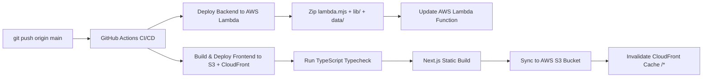

# JetFreight Digital Booking Experience Hub (Project Atlas)

A full-stack, enterprise-grade digital air freight marketplace engineered for **Jet Freight Logistics Ltd (JFLL)**. The platform streamlines international air export rate discovery, dynamic IATA weight-break quote calculations, multi-carrier rate comparisons, heavy cargo spot allocations (>500 kg), frictionless JFLL partner verification, 3-step guided booking, automated operational email dispatch, and milestone shipment tracking.

---

## 🏛️ Application Architecture

The repository is organized as a unified, high-performance monorepo powered by **pnpm workspaces**:

```
Booking-Experience-Hub/
├── client/                         ──► Next.js 15.5 & React 19 Frontend Web Application
│   ├── src/
│   │   ├── app/                    ──► Next.js App Router (Layout, Page, Metadata)
│   │   ├── components/             ──► UI/UX Pro design system components & modals
│   │   │   ├── form/               ──► Unified FormControls (Field, StyledSelect, CustomDatePicker)
│   │   │   ├── modals/             ──► QuickTrackModal, InfoModals, and overlays
│   │   │   └── rates/              ──► Heavy cargo spot allocation desk & inquiry form
│   │   ├── data/                   ──► Consolidated offline fallback rates & locations
│   │   ├── services/               ──► Rate discovery client service & spot inquiry dispatch
│   │   ├── App.tsx                 ──► Main application coordinator & stepped wizard
│   │   └── index.css               ──► Tailwind CSS 4 design tokens & .booking-input typography
│   ├── public/airlines/            ──► Cached carrier airline vector and high-res PNG logos
│   └── package.json
│
├── server/                         ──► Zero-Dependency Native Node.js & Serverless API
│   ├── standalone-api.mjs          ──► Native HTTP server for local dev (zero npm deps, port 4000)
│   ├── lambda.mjs                  ──► AWS Lambda serverless handler (< 50 KB deployment bundle)
│   ├── lib/
│   │   ├── freight-domain.mjs      ──► IATA weight breaks, break-even slabs, 0.5kg rounding & CCR
│   │   ├── storage.mjs             ──► Atomic file-backed persistence for bookings and inquiries
│   │   ├── email-service.mjs       ──► Native RFC 2822 MIME compiler & AWS SES / SMTP dispatcher
│   │   └── security.mjs            ──► Input sanitization, 64KB bounded stream, defense headers
│   ├── data/                       ──► Consolidated master air freight tariff CSVs
│   ├── tests/                      ──► Automated test suite (rating, security, partner storage)
│   │   ├── rates.test.mjs
│   │   └── security.test.mjs
│   └── package.json
│
├── .github/workflows/              ──► Automated CI/CD Pipeline
│   └── deploy-aws.yml              ──► Parallel GitHub Actions deploy to AWS Lambda, S3 & CloudFront
│
├── package.json                    ──► Root workspace configuration & shortcut scripts
├── pnpm-workspace.yaml             ──► pnpm monorepo package registry
├── AWS_DEPLOYMENT_GUIDE.md         ──► Step-by-step AWS deployment and CI/CD guide
└── README.md                       ──► Platform overview & architectural documentation
```

---

## ⚡ Core Features & Systems

### 1. Dynamic IATA Rate & Surcharge Engine (< 500 kg)
* **Standard IATA Weight Breaks**: Evaluates step tariffs across standard IATA breaks: $\text{Normal } (-45\text{kg}), +45\text{kg}, +100\text{kg}, +250\text{kg}, +300\text{kg}, +500\text{kg}, +1000\text{kg}$.
* **Break-Even Slab Rating**: Automatically evaluates whether rating a shipment at the next weight threshold yields a lower total freight charge, subject to the statutory minimum charge floor.
* **IATA TACT Rule 1.3.2 Rounding**: Chargeable weight automatically rounds up to the next 0.5 kg (e.g. $240.2\text{ kg} \rightarrow 240.5\text{ kg}$).
* **Multi-Unit Cargo Dimensioning**:
  * Dimension Mode: Accepts Length, Breadth, Height with unit toggles (`cm`, `in`, `m`, `mm`) and calculates:
    $$\text{Volumetric Weight (kg)} = \frac{L \times B \times H \times \text{pieces}}{6000}$$
  * Direct CBM Mode: Computes volumetric weight at standard air freight density ($1\text{ CBM} = 167\text{ kg}$).
  * Chargeable Weight is determined as $\max(\text{Gross Weight}, \text{Volumetric Weight})$.
* **Commodity Class Rating (CCR Rule 2.2)**: Configurable surcharges for specialized freight types:
  * General Cargo (Standard)
  * Dangerous Goods / Hazmat (+25% surcharge)
  * Temperature-Controlled Pharma (+20% surcharge)
  * Perishables / Food (+15% surcharge)
  * Valuable Cargo / High-Security (+30% surcharge)
  * Live Animals / AVI (+20% surcharge)
* **All-Inclusive Freight Pricing**: Automatically itemizes fuel (FSC), security (SSC), terminal handling (THC), X-ray screening, AWB issuance, cartage (CTG), and 5% Indian export GST into a unified tariff with a transparent 4% commercial freight margin.

### 2. Frictionless Returning Partner Verification (No Login Wall)
* **Replaced Forced Corporate Login**: The platform removes all intrusive login walls and authentication hurdles.
* **Returning JFLL Partner Verification**: Users answer a streamlined verification prompt: *"Have you previously worked with JFLL?"*
* **Account Linking**: If "Yes", captures member ID, client ID, or company name (e.g., `JFLL-MUM-8921` or registered corporate name) to link their profile for priority operations desk handling.
* **Clean Rate Presentation**: Special internal contract rates are withheld from on-screen displays for existing clients; all options show verified standard tariffs without distracting rate-lock cards.

### 3. Heavy Cargo Spot Allocation Desk (> 500 kg)
* Shipments exceeding $500\text{ kg}$ automatically transition from standard retail tariffs to the dedicated **Heavy Cargo Spot Desk**.
* Collects detailed shipper contact information, company details, 10-digit DGFT IEC code, and cargo handling requirements (palletized, temperature controlled, forklift needed).
* Generates an official RFQ reference (e.g., `JFLL-RFQ-2026-44297`) with a 2-hour SLA response window and priority pricing desk escalation.

### 4. UI/UX Pro Design System & Form Harmonization
* **Typography Standardization**: Form controls follow a strict design hierarchy:
  * Input values: `text-xs` (`12px` / `0.75rem`), `font-semibold` (weight 600), `#101820` text color.
  * Input placeholders: `text-xs` (`12px`), `font-normal` (weight 400), `#908e92` muted color.
  * Input labels: `text-[11px]`, uppercase bold tracking (`.08em`), `#4d5b62`.
* **Pixel-Perfect Alignment**: All inputs, select triggers, date pickers, and the fixed Origin Gateway (Mumbai BOM) share an identical `46px` box height and `padding: 0 14px`.
* **Zero External Component Dependencies**: Form controls, custom dropdowns, and date pickers use lightweight native SVG icons (Lucide) and Tailwind CSS 4 transitions without third-party widget bloat.

### 5. Enterprise Security & Zero-Dependency Backend
* **Zero npm Dependencies**: The backend (`server/`) is written in 100% native Node.js ESM. It requires 0 external npm packages, packaging into a lightweight ~50 KB bundle.
* **Native MIME Email Service**: Email generation uses a built-in RFC 2822 multipart/alternative MIME compiler with automated HTML entity escaping to prevent template injection.
* **Streaming Payload Bounds**: All incoming request bodies are capped at 64 KB using bounded streaming buffers to prevent memory exhaustion and DoS attacks.
* **Input Sanitization**: Incoming strings are sanitized to strip control characters and HTML tags.
* **Security Headers**: API responses enforce `X-Content-Type-Options: nosniff`, `X-Frame-Options: DENY`, `Strict-Transport-Security`, and restrictive CORS headers.

---

## 🛠️ Technology Stack

| Layer | Technologies |
| :--- | :--- |
| **Frontend** | Next.js 15.5 (App Router), React 19, Tailwind CSS 4, Framer Motion 12, Lucide Icons |
| **Backend** | Native Node.js ESM (v20/v22), Zero External Dependencies |
| **Serverless Engine** | AWS Lambda (`server/lambda.mjs`) & Standalone HTTP (`server/standalone-api.mjs`) |
| **Cloud Hosting** | AWS S3 (Static Web Origin), AWS CloudFront (Global CDN), AWS Lambda (Serverless API) |
| **Email Transport** | AWS SES / Native SMTP (RFC 2822 MIME compilation) |
| **Testing** | Node.js Test Runner (`node --test`), Playwright MCP for UI validation |
| **Package Manager** | pnpm workspaces (v11.15.1) |

---

## 🚀 Local Development

### Prerequisites
* **Node.js** >= 20 (Node 22 LTS recommended)
* **pnpm** >= 10 (`pnpm@11.15.1` recommended)

### 1. Install Dependencies
```bash
# Install workspace dependencies from the root
pnpm install
```

### 2. Run the Backend API Server (Port 4000)
```bash
# From workspace root:
pnpm dev:api

# Or directly in server directory:
node server/standalone-api.mjs
# Health check: http://localhost:4000/api/health
```

### 3. Run the Frontend Client (Port 3000)
```bash
# From workspace root:
pnpm dev

# Or directly in client directory:
cd client && pnpm dev
# Live preview: http://localhost:3000
```

### 4. Run the Test Suite
```bash
# Runs rating engine, security sanitization, and partner persistence tests
pnpm test
```

### 5. Production Build & Static Export
```bash
# Run TypeScript type check
pnpm typecheck

# Build optimized static production bundle into client/out
pnpm build
```

---

## ☁️ Automated AWS CI/CD Pipeline

The repository features an automated GitHub Actions deployment pipeline ([`.github/workflows/deploy-aws.yml`](./.github/workflows/deploy-aws.yml)) that deploys on every push to `main`:



### Deployment Pipeline Highlights
* **Parallel Execution**: Backend and frontend deploy concurrently to reduce CI execution time to under 1 minute.
* **Instant Lambda Packaging**: Packaging takes ~7 seconds because the backend has zero external dependencies.
* **Cache-Busting Static Sync**: HTML files are uploaded with `Cache-Control: no-cache, no-store, must-revalidate`, while hashed assets receive `max-age=31536000, immutable`.
* **Edge Invalidation**: Automatically triggers a CloudFront `/*` invalidation upon sync so updates are visible globally without stale edge caching.

For step-by-step instructions on setting up AWS credentials and GitHub repository secrets, refer to:
👉 **[AWS_DEPLOYMENT_GUIDE.md](./AWS_DEPLOYMENT_GUIDE.md)**

---

## 📄 License

Proprietary — Developed for **Jet Freight Logistics Ltd (JFLL)**. All rights reserved.
