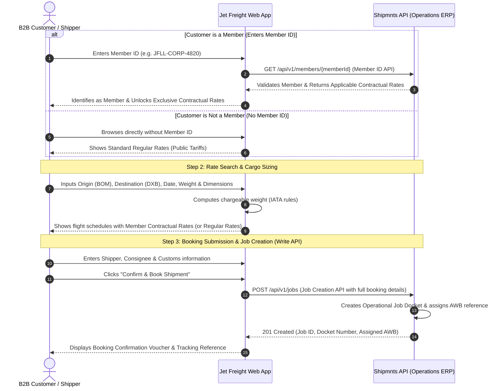

# Jet Freight Booking Experience Hub — Shipmnts Integration Guide

Welcome to the **Jet Freight Booking Experience Hub** documentation. 

This guide is written in plain, developer-friendly language to help any new developer or engineer quickly understand how our customer-facing web application works, what data it collects from users, and how it connects to our operational software, **Shipmnts**.

---

## 1. Project Overview

### 1.1 What is this Application?
The **Jet Freight Booking Experience Hub** is a modern, self-service web platform designed for Jet Freight Logistics' B2B customers, exporters, and cargo shippers. 

Instead of calling customer support or sending endless emails, customers can use this application to:
1. Identify themselves as a **Member** using their **Member ID** (or proceed as a regular customer).
2. Plan an air freight shipment (choose origin, destination, and ready date).
3. Enter cargo weight and package dimensions in multiple units ($cm$, $in$, $m$, $mm$).
4. View live airline rates, flight schedules, and **applicable contractual rates** (if they are a member).
5. Fill in shipper, consignee, and customs details (GSTIN, IEC, AD Code).
6. Confirm their air freight booking in a few clicks.

### 1.2 Core Business Rule: Regular Rates vs. Contractual Rates
It is critical for developers to understand the distinction between regular and member customers:
* **Purpose of the Member ID**: The Member ID is used **solely to identify whether a customer is an enrolled member** in the Shipmnts system.
* **Contractual Rates (Members Only)**: Contractual rates are provided **only to members**. These rates are negotiated agreements between Jet Freight and the member enterprise, featuring custom rate slabs, preferred airline allotments, or percentage discounts. **Contractual rates are completely different from our regular rates.**
* **Regular Rates (Non-Members)**: If a customer is not a member (or does not enter a valid Member ID), they will see and be quoted our standard **regular rates**.

### 1.3 Why Are We Integrating with Shipmnts?
**Shipmnts** is the core operational ERP and freight management software used internally by Jet Freight's operations team.

When a customer books a shipment on our web portal, our team does not want to manually copy and paste details into Shipmnts. Instead:
- Our web application communicates directly with the **Shipmnts API**.
- Shipmnts checks the customer's **Member ID** to verify membership status and returns their **contractual rates**.
- Once the customer confirms the booking, our web application automatically creates an **operational Job** in Shipmnts.
- The Jet Freight operations team sees the job immediately in their Shipmnts dashboard, issues the Air Waybill (AWB), and coordinates with the airlines.

---

## 2. How the Integration Works (Step-by-Step Flow)

Here is a simple visual flow showing how our web portal and Shipmnts talk to each other:



---

## 3. Complete Inventory of User Inputs

Below is a complete breakdown of every piece of information we collect from customers across the application, categorized by section.

---

### 3.1 Member Identification (Login / Header)

| Field Name | Code / JSON Key | Required? | Description | Example |
| :--- | :--- | :---: | :--- | :--- |
| **Member ID** | `memberId` | Optional (Required for Member Rates) | Used **only to identify whether a customer is a member**. Contractual rates will be provided **only to members**, and these rates are **different from our regular rates**. Regular customers can proceed without a Member ID and will see regular rates. | `JFLL-CORP-4820` |
| **Company Name** | `companyName` | Auto-filled | The registered legal trade name linked to this Member ID in Shipmnts. | `Apex Industrial Exports Ltd` |

---

### 3.2 Shipment Route & Schedule

| Field Name | Code / JSON Key | Required? | Description | Example |
| :--- | :--- | :---: | :--- | :--- |
| **Origin Airport** | `origin` | **Yes** | 3-letter IATA airport code for cargo departure (default: Mumbai `BOM`). | `BOM` |
| **Destination Airport** | `destination` | **Yes** | 3-letter IATA airport code for cargo arrival. | `DXB` (Dubai) |
| **Cargo Ready Date** | `readyDate` | **Yes** | The date when cargo will be packed and ready for handover. | `2026-10-25` |
| **Commodity Category** | `cargoType` | **Yes** | Type of goods. Options: `General cargo`, `Express courier`, `Pharma healthcare`, `Dangerous goods`, `Perishables`. | `General cargo` |

---

### 3.3 Cargo Sizing, Weight & Dimension Lines

Customers can enter their cargo specifications either by entering total dimensions or piece-by-piece packing lines.

| Field Name | Code / JSON Key | Required? | Description | Example |
| :--- | :--- | :---: | :--- | :--- |
| **Total Number of Pieces** | `pieces` | **Yes** | Total count of boxes, cartons, or pallets. | `10` |
| **Total Gross Weight** | `grossWeight` | **Yes** | Actual physical scale weight in kilograms ($kg$). | `450.0` |
| **Dimension Mode** | `dimensionMode` | Optional | Whether customer enters `dimensions` ($L \times W \times H$) or direct `cbm` (Cubic Meters). | `dimensions` |
| **Measurement Unit** | `unit` | Optional | Unit used for length, width, height: `cm`, `in`, `m`, or `mm` (defaults to `cm`). | `cm` |
| **Length** | `length` | Optional | Length per piece/box. | `60.0` |
| **Width / Breadth** | `width` | Optional | Width per piece/box. | `40.0` |
| **Height** | `height` | Optional | Height per piece/box. | `40.0` |
| **Total Volume (CBM)** | `volume` | Auto-computed | Total volume in cubic meters ($m^3$). | `0.96` |
| **Volumetric Weight** | `volumetricWeight` | Auto-computed | Computed using IATA standard: $(L \times W \times H \times \text{pieces}) / 6000$ (in $cm$). | `160.0` |
| **Chargeable Weight** | `chargeableWeight` | Auto-computed | The higher of Gross Weight vs Volumetric Weight, rounded to next 0.5 kg. | `450.0` |

#### Detailed Packing Lines (Multi-Package Support)
When customers have packages of varying sizes, they enter multiple lines:

```json
[
  {
    "pieces": 5,
    "length": 60,
    "width": 40,
    "height": 40,
    "unit": "cm",
    "weightPerPiece": 25.0
  },
  {
    "pieces": 5,
    "length": 80,
    "width": 50,
    "height": 50,
    "unit": "cm",
    "weightPerPiece": 65.0
  }
]
```

---

### 3.4 Shipper / Exporter Details (Indian Customs Compliance)

Under Indian Customs regulations (ICEGATE), air cargo exports require strict trade identifiers.

| Field Name | Code / JSON Key | Required? | Description | Example |
| :--- | :--- | :---: | :--- | :--- |
| **Shipper Legal Name** | `shipperCompany` | **Yes** | Legal registered name of the exporting entity. | `Apex Industrial Exports Ltd` |
| **Contact Person** | `shipperName` | **Yes** | Full name of shipping coordinator. | `Ramesh Kumar` |
| **Shipper Email** | `shipperEmail` | **Yes** | Email for booking notifications and shipping bills. | `ramesh.kumar@apexexports.in` |
| **Shipper Phone** | `shipperPhone` | **Yes** | Contact number with country code. | `+91 98200 12345` |
| **Registered Address** | `shipperAddress` | **Yes** | Complete address matching GST registration. | `Plot 42, MIDC, Andheri East, Mumbai 400093` |
| **GSTIN** | `shipperGstin` | **Yes** | 15-digit Indian Goods & Services Tax Number. | `27AABCA1234F1Z8` |
| **IEC Number** | `shipperIec` | **Yes** | 10-digit Importer Exporter Code issued by DGFT. | `0312049281` |
| **Bank AD Code** | `adCode` | Optional | 7 or 14-digit Authorized Dealer Code registered with Customs. | `0290041` |

---

### 3.5 Consignee / Receiver Details (Overseas Buyer)

| Field Name | Code / JSON Key | Required? | Description | Example |
| :--- | :--- | :---: | :--- | :--- |
| **Consignee Company** | `consigneeCompany` | **Yes** | Legal business name of the overseas buyer/importer. | `Al-Futtaim Trading LLC` |
| **Contact Person** | `consigneeName` | **Yes** | Name of the recipient contact. | `Tariq Al-Mansoor` |
| **Consignee Email** | `consigneeEmail` | **Yes** | Recipient email for arrival notices. | `tariq.mansoor@alfuttaim.ae` |
| **Consignee Phone** | `consigneePhone` | **Yes** | Overseas telephone number with country code. | `+971 4 212 9876` |
| **Delivery Address** | `consigneeAddress` | **Yes** | Physical delivery address in destination country. | `Warehouse 14, Al Quoz Industrial 3, Dubai, UAE` |
| **Tax ID / VAT No.** | `consigneeTaxId` | Optional | Local destination tax number (e.g. UAE TRN, EU EORI). | `100239481700003` |

---

### 3.6 Cargo Specifications & Compliance

| Field Name | Code / JSON Key | Required? | Description | Example |
| :--- | :--- | :---: | :--- | :--- |
| **Cargo Description** | `cargoDescription` | **Yes** | Clear commercial description of goods for the AWB and customs. | `Automotive Precision Brass Valves & Fittings` |
| **HS Code** | `hsCode` | **Yes** | 6 to 8-digit Harmonized System tariff code. | `8481.80.90` |
| **Packaging Type** | `packagingType` | **Yes** | Form of packing (`Corrugated Cartons`, `Wooden Crates (ISPM-15)`, `Drums / Barrels`, `Palletized Unit`). | `Corrugated Cartons` |
| **Incoterm** | `incoterm` | **Yes** | Delivery term (`CIP`, `CPT`, `FOB`, `CIF`, `DAP`, `EXW`). | `CIP` |
| **Temperature Condition** | `tempCondition` | Optional | Required for pharma/perishables (`None`, `Cold Chain (+2° to +8°C)`, `Controlled Room Temp (+15° to +25°C)`). | `None` |
| **Dangerous Goods UN #**| `dgUnNumber` | Optional | 4-digit UN number if cargo contains hazardous materials. | `UN 1993` |
| **Door Pickup Required**| `doorPickup` | Optional | Boolean flag indicating whether customer needs warehouse collection. | `true` or `false` |

---

## 4. Required API Endpoints from Shipmnts

We require two specific endpoints from Shipmnts to complete the integration:

```
┌───────┬────────────────────────────────────────┬────────────────────────────────────────────┐
│ VERB  │ ENDPOINT ROUTE                         │ PURPOSE                                    │
├───────┼────────────────────────────────────────┼────────────────────────────────────────────┤
│ GET   │ /api/v1/members/{memberId}             │ 1. Member ID API (Read): Fetch profile &   │
│       │                                        │    applicable contractual rates            │
├───────┼────────────────────────────────────────┼────────────────────────────────────────────┤
│ POST  │ /api/v1/jobs                           │ 2. Job Creation API (Write): Send booking   │
│       │                                        │    details to create a new job in Shipmnts │
└───────┴────────────────────────────────────────┴────────────────────────────────────────────┘
```

---

### 4.1 Endpoint 1: Member ID API (Read)

#### Why We Need This
The Member ID API serves two primary operational objectives:
1. **Identify whether a customer is a member**: The Member ID is used **strictly to identify whether the customer is an enrolled member** in the Shipmnts database. Customers without a Member ID are treated as regular customers and receive our standard regular rates.
2. **Retrieve applicable contractual rates**: Contractual rates are provided **only to members**, and these rates are **different from our regular rates**. When a valid Member ID is verified, this endpoint returns the member's negotiated rates (or discount structures) so the portal can display their exclusive contractual pricing.
3. **Pre-fill company trade details**: Returns verified company data (Legal name, GSTIN, IEC, AD Code, registered address) to streamline form filling.

#### Endpoint Details
- **Method:** `GET`
- **Path:** `/api/v1/members/{memberId}`
- **Optional Query Parameters:**
  - `origin`: (e.g. `BOM`) to filter contract rates for a specific origin airport.
  - `destination`: (e.g. `DXB`) to filter contract rates for a specific destination.
- **Request Headers:**
  ```http
  GET /api/v1/members/JFLL-CORP-4820?origin=BOM&destination=DXB HTTP/1.1
  Host: api.shipmnts.com
  Authorization: Bearer <SHIPMNTS_API_TOKEN>
  Accept: application/json
  ```

#### Expected Success Response (HTTP 200 OK)
```json
{
  "success": true,
  "statusCode": 200,
  "data": {
    "memberId": "JFLL-CORP-4820",
    "accountStatus": "ACTIVE",
    "isCreditApproved": true,
    "paymentTerms": "NET_30",
    "company": {
      "legalName": "Apex Industrial Exports Ltd",
      "tradeName": "Apex Exports",
      "gstin": "27AABCA1234F1Z8",
      "iecNumber": "0312049281",
      "adCode": "0290041"
    },
    "registeredAddress": {
      "addressLine1": "Plot 42, MIDC Industrial Area",
      "addressLine2": "Andheri East",
      "city": "Mumbai",
      "state": "Maharashtra",
      "postalCode": "400093",
      "country": "India"
    },
    "primaryContact": {
      "name": "Ramesh Kumar",
      "email": "ramesh.kumar@apexexports.in",
      "phone": "+91 98200 12345"
    },
    "contractualRates": {
      "hasContract": true,
      "contractId": "CTR-2026-APEX-019",
      "contractTitle": "Apex Global Air Export Master Agreement 2026",
      "globalDiscountPercentage": 15.0,
      "laneRates": [
        {
          "origin": "BOM",
          "destination": "DXB",
          "cargoCategory": "General cargo",
          "preferredCarrier": "Kuwait Airways",
          "preferredCarrierCode": "KU",
          "pricingType": "NET_SLAB",
          "currency": "INR",
          "rateSlabs": {
            "minRate": 1200.0,
            "normal": 115.0,
            "plus45kg": 95.0,
            "plus100kg": 72.0,
            "plus250kg": 65.0,
            "plus300kg": 60.0,
            "plus500kg": 54.0,
            "plus1000kg": 48.0
          }
        }
      ]
    }
  }
}
```

#### Error Response (Member Not Found - HTTP 404)
```json
{
  "success": false,
  "statusCode": 404,
  "errorCode": "MEMBER_NOT_FOUND",
  "message": "No active member found with ID 'JFLL-CORP-9999'."
}
```

---

### 4.2 Endpoint 2: Job Creation API (Write)

#### Why We Need This
Once the customer reviews their flight option, enters the shipper and consignee information, and clicks **"Confirm Booking"**, our application calls this API to send the complete booking payload to Shipmnts. 

Shipmnts will then:
1. Automatically create a new **operational Job** in the Shipmnts database.
2. Generate an internal **Job / Docket Number**.
3. Reserve or link an **Air Waybill (AWB)** number.
4. Notify Jet Freight's operations team so they can process the cargo immediately.

#### Endpoint Details
- **Method:** `POST`
- **Path:** `/api/v1/jobs`
- **Request Headers:**
  ```http
  POST /api/v1/jobs HTTP/1.1
  Host: api.shipmnts.com
  Authorization: Bearer <SHIPMNTS_API_TOKEN>
  Content-Type: application/json
  Idempotency-Key: JFLL-AE-2026-48921-UUID
  ```

#### Sample Request Payload (What our App Sends to Shipmnts)
```json
{
  "portalReference": "JFLL-AE-2026-48921",
  "memberId": "JFLL-CORP-4820",
  "bookingSource": "JETFREIGHT_WEB_PORTAL",
  "bookingTimestamp": "2026-10-18T23:00:00Z",
  "routing": {
    "origin": "BOM",
    "destination": "DXB",
    "readyDate": "2026-10-25",
    "cargoCategory": "General cargo"
  },
  "flightSelection": {
    "carrierName": "Kuwait Airways",
    "carrierCode": "KU",
    "flightNumber": "KU-384",
    "departureTime": "06:15",
    "arrivalTime": "08:30",
    "transitTime": "3h 45m"
  },
  "cargoDetails": {
    "totalPieces": 10,
    "grossWeightKg": 450.0,
    "volumetricWeightKg": 160.0,
    "chargeableWeightKg": 450.0,
    "volumeCbm": 0.96,
    "packagingType": "Corrugated Cartons",
    "commodityDescription": "Automotive Precision Brass Valves & Fittings",
    "hsCode": "8481.80.90",
    "incoterm": "CIP",
    "tempCondition": "None",
    "isDangerousGoods": false,
    "dgUnNumber": null,
    "doorPickupRequired": false,
    "dimensionLines": [
      {
        "pieces": 5,
        "length": 60.0,
        "width": 40.0,
        "height": 40.0,
        "unit": "cm",
        "weightPerPieceKg": 25.0
      },
      {
        "pieces": 5,
        "length": 80.0,
        "width": 50.0,
        "height": 50.0,
        "unit": "cm",
        "weightPerPieceKg": 65.0
      }
    ]
  },
  "parties": {
    "shipper": {
      "companyName": "Apex Industrial Exports Ltd",
      "contactPerson": "Ramesh Kumar",
      "email": "ramesh.kumar@apexexports.in",
      "phone": "+91 98200 12345",
      "address": "Plot 42, MIDC Industrial Area, Andheri East, Mumbai 400093",
      "gstin": "27AABCA1234F1Z8",
      "iec": "0312049281",
      "adCode": "0290041"
    },
    "consignee": {
      "companyName": "Al-Futtaim Trading LLC",
      "contactPerson": "Tariq Al-Mansoor",
      "email": "tariq.mansoor@alfuttaim.ae",
      "phone": "+971 4 212 9876",
      "address": "Warehouse 14, Al Quoz Industrial 3, Dubai, UAE",
      "taxId": "100239481700003"
    }
  },
  "commercialSummary": {
    "currency": "INR",
    "ratePerKg": 54.0,
    "baseFreight": 24300.0,
    "fuelAndSecuritySurcharge": 3600.0,
    "terminalHandlingCharge": 1800.0,
    "customsClearanceFee": 2500.0,
    "subtotal": 32200.0,
    "taxGst18": 5796.0,
    "finalContractTotal": 37996.0,
    "appliedContractDiscount": "15% Corporate Tier Rate"
  }
}
```

#### Expected Success Response from Shipmnts (HTTP 201 Created)
```json
{
  "success": true,
  "statusCode": 201,
  "message": "Job successfully created in Shipmnts",
  "data": {
    "jobId": "SHP-JOB-2026-BOM-09142",
    "docketNumber": "DKT-BOM-8921",
    "portalReference": "JFLL-AE-2026-48921",
    "awbNumber": "229-84729104",
    "jobStatus": "BOOKED",
    "assignedBranch": "BOM-AIR",
    "createdAt": "2026-10-18T23:00:02Z",
    "trackingUrl": "https://app.shipmnts.com/track/SHP-JOB-2026-BOM-09142"
  }
}
```

---

## 5. Developer Quick Reference: Field Mapping Table

This table helps backend and frontend developers map each field in our web form to the corresponding key in the Shipmnts API payload.

| Web Form Field | Shipmnts JSON Field | Data Type | Required? | Notes |
| :--- | :--- | :--- | :---: | :--- |
| Portal Booking Ref | `portalReference` | String | Yes | Unique ID generated by our portal |
| Member ID | `memberId` | String | Yes | Identifier from Member Read API |
| Origin Airport | `routing.origin` | String | Yes | 3-letter IATA code (`BOM`) |
| Destination Airport | `routing.destination` | String | Yes | 3-letter IATA code (`DXB`) |
| Cargo Ready Date | `routing.readyDate` | String | Yes | `YYYY-MM-DD` |
| Commodity Category | `routing.cargoCategory` | String | Yes | E.g. `General cargo` |
| Selected Carrier | `flightSelection.carrierName` | String | Yes | E.g. `Kuwait Airways` |
| Carrier Code | `flightSelection.carrierCode` | String | Yes | 2-letter IATA airline code (`KU`) |
| Total Pieces | `cargoDetails.totalPieces` | Number | Yes | Positive integer |
| Gross Weight | `cargoDetails.grossWeightKg` | Number | Yes | Scale weight in kg |
| Volumetric Weight | `cargoDetails.volumetricWeightKg`| Number | Yes | Calculated via $(L \times W \times H)/6000$ |
| Chargeable Weight | `cargoDetails.chargeableWeightKg`| Number | Yes | Higher of gross vs volumetric |
| Packing Type | `cargoDetails.packagingType` | String | Yes | E.g. `Corrugated Cartons` |
| Cargo Description | `cargoDetails.commodityDescription` | String | Yes | Plain text cargo description |
| HS Code | `cargoDetails.hsCode` | String | Yes | 6 to 8-digit tariff code |
| Incoterm | `cargoDetails.incoterm` | String | Yes | E.g. `CIP`, `FOB`, `CIF` |
| Shipper Company | `parties.shipper.companyName` | String | Yes | Exporter legal entity name |
| Shipper GSTIN | `parties.shipper.gstin` | String | Yes | 15-character Indian tax ID |
| Shipper IEC | `parties.shipper.iec` | String | Yes | 10-digit DGFT Export Code |
| Shipper AD Code | `parties.shipper.adCode` | String | No | Bank authorized dealer code |
| Consignee Company | `parties.consignee.companyName` | String | Yes | Overseas buyer name |
| Consignee Address | `parties.consignee.address` | String | Yes | Overseas delivery address |
| Total Contract Amount | `commercialSummary.finalContractTotal`| Number | Yes | Final price charged to customer |

---

## 6. Information & Checklist Requested from Shipmnts Team

To connect our application to Shipmnts without delay, we request the Shipmnts technical team to provide the following details:

```
┌────┬──────────────────────────────────────┬──────────────────────────────────────────────────┐
│ #  │ TECHNICAL ITEM                       │ DETAILS NEEDED FROM SHIPMNTS                     │
├────┼──────────────────────────────────────┼──────────────────────────────────────────────────┤
│ 1  │ Sandbox / Staging API Base URL       │ E.g. https://sandbox-api.shipmnts.com/v1         │
│ 2  │ Production API Base URL              │ E.g. https://api.shipmnts.com/v1                 │
│ 3  │ Authentication Method                │ Bearer Token / API Key / OAuth 2.0 Client ID     │
│ 4  │ Test Member IDs                      │ 2 valid Member IDs in Sandbox with contract rates│
│ 5  │ Contract Rate Structure              │ Format in which member contract tariffs are      │
│    │                                      │ returned (net fixed slabs vs % discount)         │
│ 6  │ Webhook Support                      │ Can Shipmnts send webhooks to our app on status  │
│    │                                      │ changes (e.g. AWB Generated, Cargo Tendered)?    │
│ 7  │ Rate Limits & Throttling             │ Max requests per second (RPS) allowed            │
└────┴──────────────────────────────────────┴──────────────────────────────────────────────────┘
```

---

## 7. Developer Notes: Environment Configuration

When implementing the API client in the application codebase, configure these environment variables in your `.env` file:

```bash
# Shipmnts API Configuration
SHIPMNTS_API_BASE_URL=https://sandbox-api.shipmnts.com/v1
SHIPMNTS_API_KEY=your_sandbox_api_key_here
SHIPMNTS_CLIENT_ID=jetfreight-booking-portal
SHIPMNTS_REQUEST_TIMEOUT_MS=10000
```

---

### Questions or Feedback?
If you have questions about this specification or need assistance with the integration:
* **Contact:** Deepak (<deepak.naidu@jfll.com>)
* **Project:** Jet Freight Logistics — Booking Experience Hub
* **Repository:** `github.com/DevAI-DeepakJFLL/jfll-booking-platform`
