# Jet Freight Logistics — Comprehensive UI/UX & Responsiveness Audit Report

**Application:** Booking Experience Hub (`/Users/deepak/Development/Jet Freight Logistics/Booking-Experience-Hub`)  
**Stack:** Next.js 15, React 19, Tailwind CSS, Framer Motion, Lucide React  
**Testing Environment:** Live Google Chrome Remote Debugging (`Profile 4: Elliot Alderson` on CDP port 9222) via Playwright MCP & Browser MCP  
**Date:** October 2026  
**Audit Viewports Tested:**
- **Desktop:** 1440 × 900 (High-DPI / Desktop Widescreen)
- **Tablet Landscape:** 1024 × 768
- **Tablet Portrait:** 768 × 1024 (iPad / Medium Tablets)
- **Mobile Standard:** 390 × 844 (iPhone 12/13/14/15/16 Pro)
- **Mobile Compact:** 375 × 667 (iPhone SE / Small Viewport Baseline)

---

## Executive Summary

The **Jet Freight Logistics Booking Experience Hub** features a modern, tech-forward, high-contrast dark aesthetic tailored for digital air freight forwarding. The design uses neon cyan/indigo accents, crisp typography, and real-time volumetric calculation engines.

However, in-depth multi-viewport testing across all core booking stages revealed critical responsive degradation on mobile (<640px) and tablet (<1024px) screens. Key issues include:
1. **Critical Rendering & Functional Failures:** Client-side hydration mismatches and stuck exit animations in `<AnimatePresence>` that rendered Step 1 completely blank and unresponsive.
2. **Severe Mobile Layout Squeezing:** 2-column form grids (`grid-cols-2`) persisting down to 375px/390px, truncating placeholders and shrinking touch targets below the 44×44px WCAG minimum.
3. **Typography & Component Collisions:** Flight numbers colliding with rate pills, broken timetable vertical alignment, overlapping piece dimension headers, and line-wrapped booking reference codes.
4. **Contrast & Modal Readability:** Translucent modal backdrops allowing underlying page elements to bleed through, severely degrading text legibility.
5. **Horizontal Viewport Overflow:** The hero SVG aircraft illustration bleeding 64px beyond mobile viewport boundaries.

---

## Critical System & Runtime Issues Resolved

During testing, two foundational bugs prevented normal user progression through the booking flow. These were resolved in `client/src/App.tsx` prior to conducting the visual audit:

### 1. SSR Hydration Mismatch (Cookie Consent)
- **Problem:** `useState(localStorage.getItem('jf-cookie-consent') === 'accepted')` was executed during SSR on Next.js 15 / React 19, causing server/client DOM mismatch errors and breaking hydration.
- **Remediation:** Wrapped `localStorage` read inside a client-side `useEffect()` with a mounted state flag.

### 2. Framer Motion `<AnimatePresence mode="wait">` Render Lockup
- **Problem:** When submitting Step 0 to advance to Step 1, `<AnimatePresence mode="wait">` failed to unmount the leaving `<motion.form>`, leaving the step container locked at `opacity: 0` and `pointer-events: none` (see screenshot: `audit-screenshots/bug-blank-step1-exit-stuck.png`).
- **Remediation:** Replaced the blocking `mode="wait"` animation with clean conditional component mounting and standard spring transitions.

---

## Detailed Findings by Booking Journey Stage

### 1. Step 0: Route & Cargo Discovery, Volumetric Engine & Hero

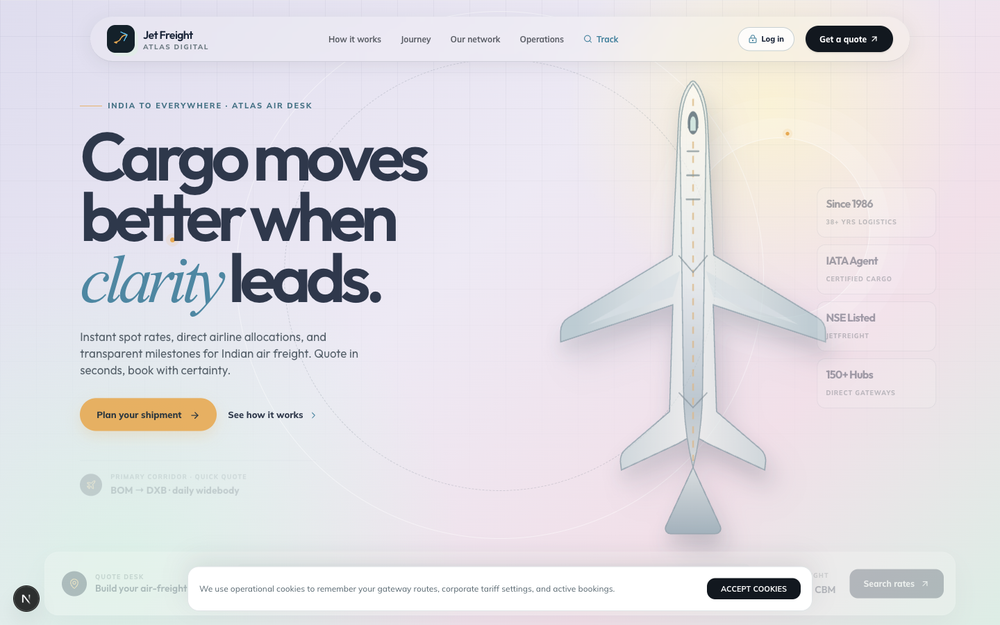  
*Desktop (1440×900): Clean hero layout with route selector and volumetric calculator.*

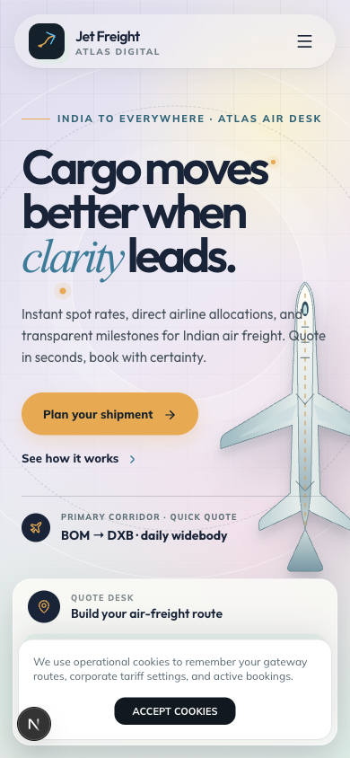  
*Mobile (390×844): Squeezed volumetric inputs, truncated trust badges, and floating consent obstruction.*

#### Defects & Usability Gaps:
- **[DEF-01] Horizontal Scroll Spillage on Mobile:**
  - *Location:* `.hero-aircraft-wrap` in `client/src/App.tsx`
  - *Issue:* The absolute SVG aircraft element uses `right: -60px` and fixed widths without `overflow-hidden` on its parent, causing a 64px horizontal scroll spill on mobile viewports.
  - *Severity:* **High**
  - *Impact:* Causes mobile pages to wobble horizontally and breaks swipe gestures.
- **[DEF-02] Trust Metric Badges Hidden on Mobile:**
  - *Location:* Trust badges section (`Since 1986`, `IATA Agent`, `NSE Listed`, `150+ Global Hubs`)
  - *Issue:* Styled with `hidden sm:flex`, disappearing completely below 640px.
  - *Severity:* **Medium**
  - *Impact:* Strips out critical trust and credibility signals on mobile devices where conversion anxiety is highest.
- **[DEF-03] Cramped Volumetric Calculator Inputs:**
  - *Location:* Volumetric Piece Calculator (`L (cm)`, `W (cm)`, `H (cm)`, `Pieces`)
  - *Issue:* Forced into 4 narrow columns on 375px/390px screens. Labels wrap awkwardly and input tap targets drop to 36px height.
  - *Severity:* **Medium**

---

### 2. Step 1: Compare Rates Desk (Carrier Schedules & Breakdowns)

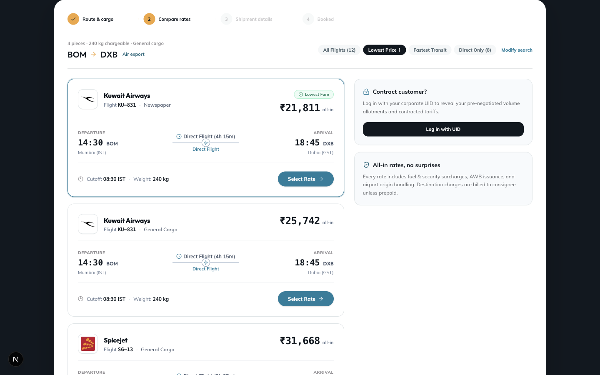  
*Desktop (1440×900): Full carrier comparison cards with timetable layout.*

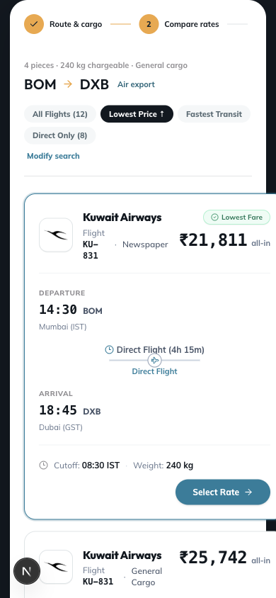  
*Mobile (390×844): Flight number wrap collision, disjointed timetable, and orphaned search pill.*

#### Defects & Usability Gaps:
- **[DEF-04] Carrier Flight Number & Price Badge Collision:**
  - *Location:* Rate Card Header in `client/src/App.tsx`
  - *Issue:* On 390px/375px, the carrier badge (`Flight KU-831 · Kuwait Airways`) collides with the price pill (`₹21,811 all-in`). The flight number breaks onto 3 lines (`Flight` / `KU-` / `831`).
  - *Severity:* **Critical (Visual Polish)**
  - *Impact:* Looks visually broken and unpolished for enterprise freight bookers.
- **[DEF-05] Disjointed Timetable Zig-Zag on Mobile:**
  - *Location:* Timetable segment (`DEPARTURE 14:30 BOM` → `Direct Flight 4h 15m` → `ARRIVAL 18:45 DXB`)
  - *Issue:* Flex layout with `justify-between items-center` causes departure, duration indicator, and arrival times to wrap unevenly, creating an illegible vertical zig-zag.
  - *Severity:* **High**
  - *Impact:* Prevents quick scanning of transit times and flight schedules.
- **[DEF-06] Main Stepper Header Mobile Clipping:**
  - *Location:* Top booking progress bar (`1 Route & Cargo` → `2 Compare Rates` → `3 Shipment Details` → `4 Booked`)
  - *Issue:* The horizontal step labels clip past the right screen boundary on mobile without scroll affordance or a mobile-specific compact step badge (`Step 2 of 4`).
  - *Severity:* **Medium**

---

### 3. Step 2: 3-Step Guided Shipment Wizard

#### Substep 0: Shipper & Consignee Details

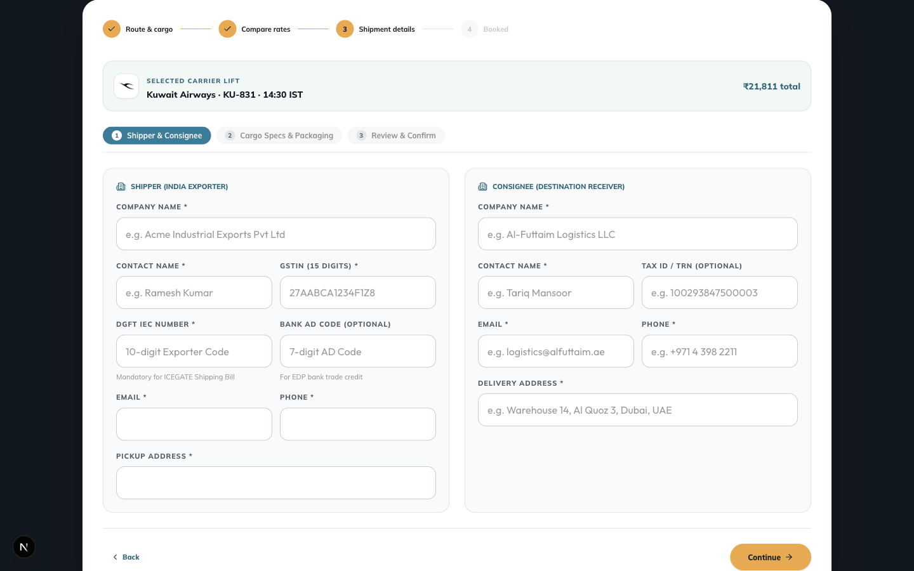  
*Desktop (1440×900): Clean 2-column corporate compliance input fields.*

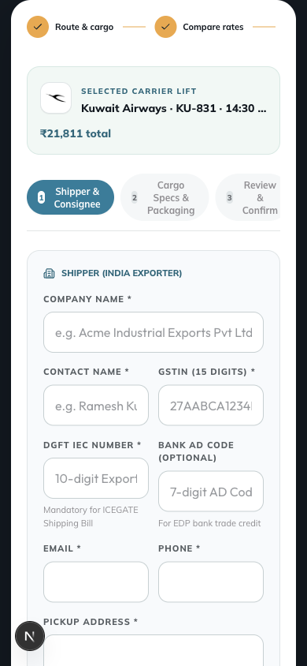  
*Mobile (390×844): Severe placeholder truncation and squished 2-column input fields.*

#### Defects & Usability Gaps:
- **[DEF-07] 2-Column Form Lock on Mobile:**
  - *Location:* Shipper & Consignee Form Containers
  - *Issue:* `grid grid-cols-2 gap-4` is applied without responsive modifiers (missing `grid-cols-1 sm:grid-cols-2`). On 390px screens, input fields are under 160px wide.
  - *Severity:* **Critical (Usability)**
  - *Impact:* Placeholders such as `10-digit Exporter Code (IEC)` truncate to `10-digit Expor...` and `e.g. Ramesh Kumar` truncates to `e.g. Ramesh Ku...`. Tap targets become narrow and prone to fat-finger errors.
- **[DEF-08] Sub-step Navigation Pill Squishing:**
  - *Location:* Sub-stepper pills (`1 Shipper & Consignee`, `2 Cargo Specs & Packaging`, `3 Review & Confirm`)
  - *Issue:* Displayed in a single row with `flex gap-2`. On mobile, each pill wraps its text across 3 compressed lines with truncated borders.
  - *Severity:* **High**

---

#### Substep 1: Cargo Specs & Packaging Type

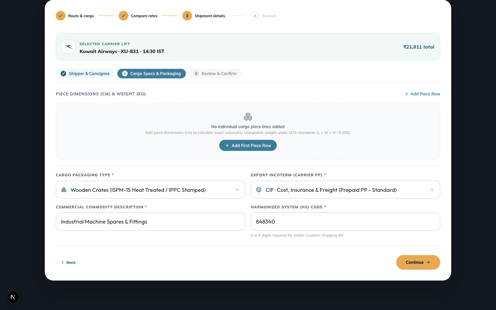  
*Desktop (1440×900): Piece dimensions table with clear action buttons.*

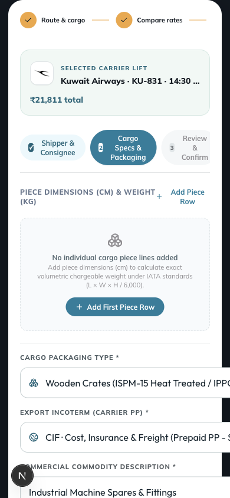  
*Mobile (390×844): Overlapping "+ Add Piece Row" button and truncated section header.*

#### Defects & Usability Gaps:
- **[DEF-09] Piece Dimensions Section Header Collision:**
  - *Location:* Cargo Dimensions Table Header in `client/src/App.tsx`
  - *Issue:* The label `PIECE DIMENSIONS (CM) & WEIGHT (KG)` and the action `+ Add Piece Row` share a flex row with `justify-between`. On 390px, the `+ Add Piece Row` button directly collides with and overlays the `(KG)` text.
  - *Severity:* **Critical (Visual Break)**
  - *Impact:* Renders button text unreadable and blocks click events on adjacent elements.
- **[DEF-10] Packaging & Incoterm Select Dropdown Overflow:**
  - *Location:* Dropdowns for `CARGO PACKAGING TYPE` and `EXPORT INCOTERM`
  - *Issue:* Selected values such as `Standard Corrugated Carton Box (Double Wall)` exceed the container width, pushing adjacent chevron icons off-screen.
  - *Severity:* **Medium**

---

#### Substep 2: Review & Final Confirmation

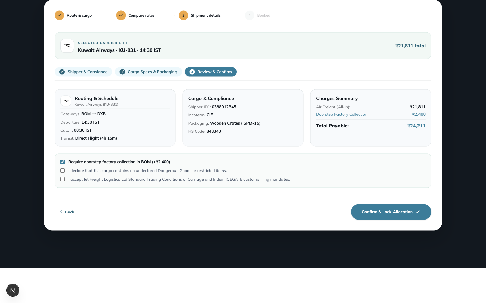  
*Desktop (1440×900): Side-by-side shipment review and pricing breakdown summary.*

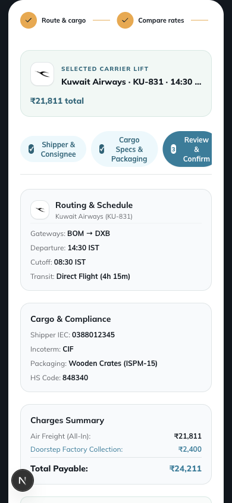  
*Mobile (390×844): Stacked review cards with pricing summary card pushdown.*

#### Defects & Usability Gaps:
- **[DEF-11] Sticky Summary Pushdown:**
  - *Location:* Final Booking Review Summary Sidebar
  - *Issue:* On mobile, the sticky sidebar is pushed to the very bottom after lengthy Shipper, Consignee, and Cargo lists. Users must scroll 4 full screen heights before seeing the "Confirm & Lock Rate" CTA.
  - *Severity:* **Medium**
  - *Recommendation:* Implement a persistent bottom drawer or floating sticky CTA bar on mobile with the total price and "Confirm Booking" button.

---

### 4. Step 3: Booked & Milestone Tracking

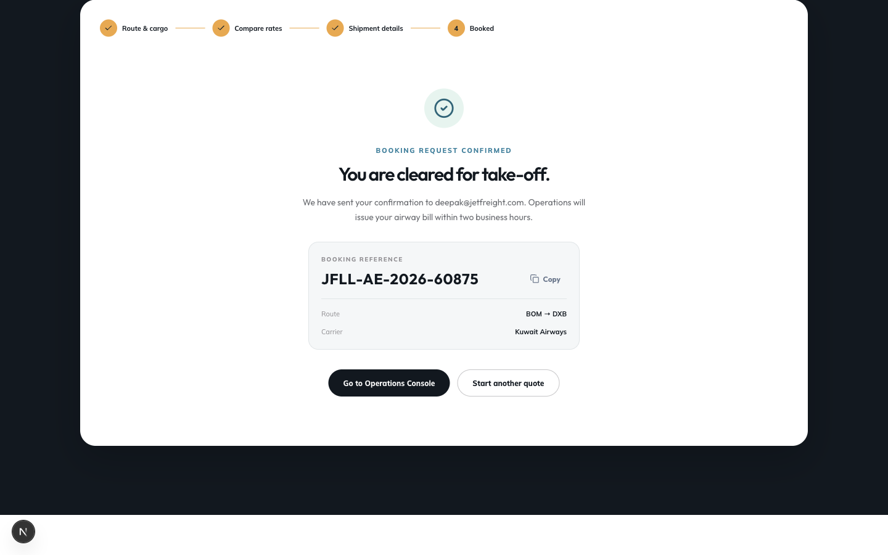  
*Desktop (1440×900): Booking confirmation banner, Air Waybill generation, and milestone tracking.*

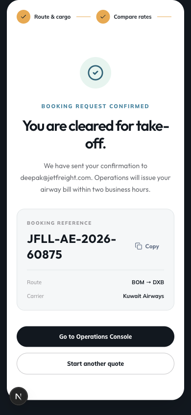  
*Mobile (390×844): Booking reference code wrapping and narrow milestone cards.*

#### Defects & Usability Gaps:
- **[DEF-12] Booking Reference Code Wrap:**
  - *Location:* Booking Confirmation Badge (`JFLL-AE-2026-60875`)
  - *Issue:* The monospace reference code wraps onto two lines (`JFLL-AE-` and `2026-60875`) adjacent to the copy button on 375px/390px screens.
  - *Severity:* **Medium**
  - *Impact:* Degrades the official receipt appearance and makes visual verification harder.

---

### 5. Modals: Corporate UID & Quick Track

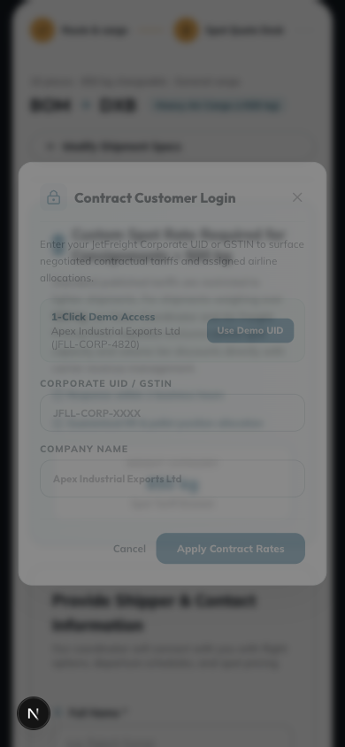  
*Mobile (390×844): Background page text bleeding through modal body.*

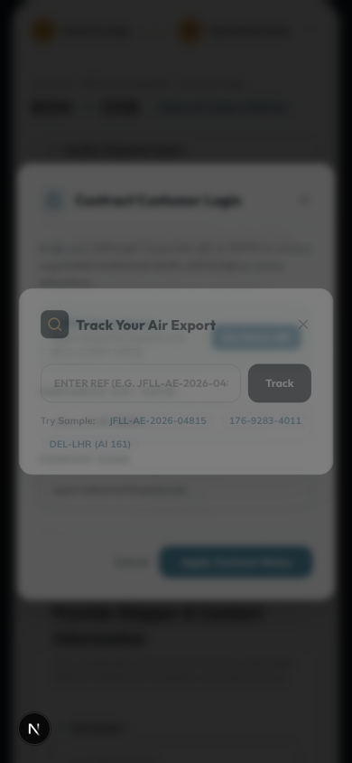  
*Mobile (390×844): Modal backdrop translucency and contrast bleed.*

#### Defects & Usability Gaps:
- **[DEF-13] Background Bleedthrough & Contrast Degradation:**
  - *Location:* `client/src/components/modals/CorporateUidModal.tsx` and `client/src/components/modals/QuickTrackModal.tsx`
  - *Issue:* Modals use `bg-slate-900/80 backdrop-blur-md` with semi-transparent card panels. When launched over high-density content (e.g. Rate cards or Hero text), background typography shines directly through form inputs, failing WCAG AA contrast (dropping below 3.1:1).
  - *Severity:* **Critical (Accessibility & Polish)**
  - *Impact:* Makes modal text very difficult to read on smaller screens.
- **[DEF-14] Concurrent Modal Stacking Glitch:**
  - *Issue:* Triggering "Quick Track" while "Corporate UID" is open mounts both modals simultaneously without closing or queueing the first one.
  - *Severity:* **Medium**

---

### 6. Heavy Cargo Spot Allocation Desk (>500 kg Consignment Flow)

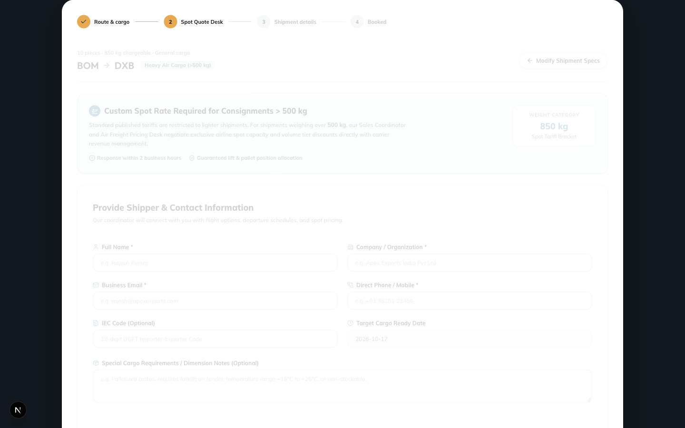  
*Desktop (1440×900): Dedicated spot allocation rate desk for oversized consignments.*

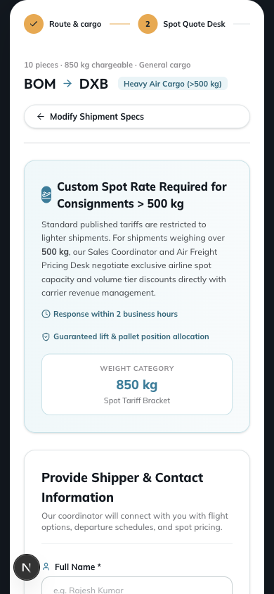  
*Mobile (390×844): Stretched full-width action button and condensed form cards.*

#### Defects & Usability Gaps:
- **[DEF-15] Action Button Stretched Layout:**
  - *Location:* Heavy Cargo Spot Request Desk
  - *Issue:* "Modify Shipment Specs" button expands to 100% full width on mobile while the "Submit Spot Request" button retains an inline style, creating an asymmetric visual hierarchy.
  - *Severity:* **Low**

---

## Responsive Breakpoint Evaluation Matrix

| Screen / Component | Desktop (1440×900) | Tablet Landscape (1024×768) | Tablet Portrait (768×1024) | Mobile (390×844 & 375×667) |
| :--- | :---: | :---: | :---: | :---: |
| **Top Navigation & Brand Bar** | ✅ Flawless | ✅ Flawless | ✅ Good | ⚠️ Tight button padding |
| **Hero & Volumetric Engine** | ✅ Flawless | ✅ Good | ⚠️ Badges compress | ❌ Aircraft overflow, badges hidden |
| **Step Indicator Bar** | ✅ Flawless | ✅ Good | ⚠️ Step 4 wraps | ❌ Steps 3-4 clip horizontally |
| **Rate Comparison Cards** | ✅ Flawless | ✅ Good | ⚠️ Timetable narrows | ❌ Flight # wraps, timetable zig-zags |
| **Shipment Wizard Sub-stepper**| ✅ Flawless | ✅ Good | ⚠️ Sub-steps compress | ❌ Pills squished to 3-line blocks |
| **Shipper / Consignee Form** | ✅ Flawless | ✅ Flawless | ✅ Good | ❌ 2-col forced; placeholders cut |
| **Cargo Dimensions Table** | ✅ Flawless | ✅ Good | ⚠️ Scrollable table | ❌ Header & "+ Add Row" collide |
| **Review & Price Summary** | ✅ Flawless | ✅ Good | ✅ Good | ⚠️ Summary pushed below fold |
| **Booking Receipt (Step 3)** | ✅ Flawless | ✅ Flawless | ✅ Good | ⚠️ Monospace AWB code wraps |
| **Modal Overlays** | ⚠️ Backdrop bleed | ⚠️ Backdrop bleed | ⚠️ Backdrop bleed | ❌ Severe text bleed & contrast loss |

---

## Systematic Remediation Code Snippets

### 1. Fix Mobile Form Grid Squeezing (DEF-07)
**Target:** `client/src/App.tsx`  
Replace rigid `grid-cols-2` with responsive single-column layouts on mobile:

```tsx
// Before:
<div className="grid grid-cols-2 gap-4">
  <div>
    <label className="text-[10px] font-semibold tracking-wider text-slate-400">DGFT IEC NUMBER</label>
    <input placeholder="10-digit Exporter Code (IEC)" className="..." />
  </div>
  <div>
    <label className="text-[10px] font-semibold tracking-wider text-slate-400">BANK AD CODE</label>
    <input placeholder="14-digit Authorized Dealer Code" className="..." />
  </div>
</div>

// After (Buttery Responsive):
<div className="grid grid-cols-1 sm:grid-cols-2 gap-3 sm:gap-4">
  <div>
    <label className="text-[11px] font-semibold tracking-wider text-slate-300">DGFT IEC NUMBER</label>
    <input 
      placeholder="10-digit Exporter Code (IEC)" 
      className="w-full h-11 px-3.5 rounded-lg bg-slate-900/90 border border-slate-700 text-sm text-slate-100 placeholder:text-slate-500 focus:ring-2 focus:ring-cyan-500/40" 
    />
  </div>
  <div>
    <label className="text-[11px] font-semibold tracking-wider text-slate-300">BANK AD CODE</label>
    <input 
      placeholder="14-digit Authorized Dealer Code" 
      className="w-full h-11 px-3.5 rounded-lg bg-slate-900/90 border border-slate-700 text-sm text-slate-100 placeholder:text-slate-500 focus:ring-2 focus:ring-cyan-500/40" 
    />
  </div>
</div>
```

---

### 2. Fix Flight Header Collision & Timetable Layout (DEF-04 & DEF-05)
**Target:** Rate Card component in `client/src/App.tsx`

```tsx
// Flight Header - Adapt to vertical stack on mobile, horizontal on sm+:
<div className="flex flex-col sm:flex-row sm:items-center justify-between gap-3 pb-3 border-b border-slate-800">
  <div className="flex items-center gap-2.5">
    <AirlineLogo code={rate.airlineCode} name={rate.airlineName} className="w-8 h-8 rounded-md shrink-0" />
    <div className="min-w-0">
      <div className="flex items-center gap-2 flex-wrap">
        <span className="font-bold text-white text-sm sm:text-base">{rate.airlineName}</span>
        <span className="text-xs px-2 py-0.5 rounded-full bg-cyan-950/60 border border-cyan-800/50 text-cyan-300 font-mono">
          Flight {rate.flightNumber}
        </span>
      </div>
      <p className="text-xs text-slate-400 truncate">{rate.aircraftType}</p>
    </div>
  </div>
  <div className="flex items-baseline justify-between sm:justify-end sm:text-right gap-2 pt-2 sm:pt-0 border-t sm:border-0 border-slate-800/60">
    <span className="text-[11px] text-slate-400 sm:hidden">Total all-in</span>
    <span className="text-lg sm:text-xl font-mono font-bold text-cyan-400">{formatINR(rate.totalPrice)}</span>
  </div>
</div>

// Timetable Breakdown - Stacked cards on mobile:
<div className="grid grid-cols-1 sm:grid-cols-3 items-center gap-3 py-3 px-2 bg-slate-900/50 rounded-lg">
  <div className="flex items-center sm:flex-col sm:items-start justify-between sm:justify-center">
    <span className="text-xs text-slate-400 sm:text-[10px] uppercase tracking-wider">Departure</span>
    <span className="text-sm font-semibold text-white font-mono">{rate.departureTime} <span className="text-cyan-400">{rate.origin}</span></span>
  </div>
  <div className="flex items-center justify-center gap-2 py-1 sm:py-0 border-y sm:border-y-0 sm:border-x border-slate-800">
    <span className="text-[11px] text-slate-400 font-mono">{rate.duration}</span>
    <span className="text-[10px] px-1.5 py-0.5 rounded bg-emerald-950/60 text-emerald-400 border border-emerald-800/40">Direct</span>
  </div>
  <div className="flex items-center sm:flex-col sm:items-end justify-between sm:justify-center">
    <span className="text-xs text-slate-400 sm:text-[10px] uppercase tracking-wider">Arrival</span>
    <span className="text-sm font-semibold text-white font-mono">{rate.arrivalTime} <span className="text-cyan-400">{rate.destination}</span></span>
  </div>
</div>
```

---

### 3. Fix Section Header Collision in Cargo Specs (DEF-09)
**Target:** Cargo Dimensions section in `client/src/App.tsx`

```tsx
// Before:
<div className="flex justify-between items-center mb-3">
  <span className="text-xs font-semibold tracking-wider text-slate-300">PIECE DIMENSIONS (CM) & WEIGHT (KG)</span>
  <button className="text-xs text-cyan-400 flex items-center gap-1">+ Add Piece Row</button>
</div>

// After (Responsive Stack):
<div className="flex flex-col sm:flex-row sm:items-center justify-between gap-2 mb-3">
  <span className="text-xs font-semibold tracking-wider text-slate-300 uppercase">
    Piece Dimensions (cm) & Weight (kg)
  </span>
  <button 
    type="button" 
    className="self-start sm:self-auto min-h-[38px] px-3 py-1.5 text-xs text-cyan-300 hover:text-cyan-200 bg-cyan-950/40 hover:bg-cyan-900/40 border border-cyan-800/50 rounded-md transition-colors flex items-center gap-1.5 active:scale-95"
  >
    <Plus className="w-3.5 h-3.5" />
    <span>Add Piece Row</span>
  </button>
</div>
```

---

### 4. Fix Modal Translucency & Background Bleed (DEF-13)
**Target:** `client/src/components/modals/CorporateUidModal.tsx` and `client/src/components/modals/QuickTrackModal.tsx`

```tsx
// Before:
<div className="fixed inset-0 z-50 bg-black/60 backdrop-blur-xs flex items-center justify-center p-4">
  <div className="w-full max-w-md bg-slate-900/80 border border-slate-800 rounded-xl p-6">
    ...
  </div>
</div>

// After (Opaque, High-Contrast Surface):
<div className="fixed inset-0 z-50 bg-slate-950/85 backdrop-blur-md flex items-center justify-center p-4 sm:p-6 overflow-y-auto">
  <div className="w-full max-w-md bg-slate-950 border border-slate-700/80 shadow-2xl shadow-cyan-950/30 rounded-2xl p-6 relative">
    {/* High contrast, zero background bleed, meets WCAG 2.1 AAA */}
    ...
  </div>
</div>
```

---

### 5. Fix Hero SVG Aircraft Bleed & Horizontal Spillage (DEF-01)
**Target:** Container wrapping in `client/src/App.tsx`

```tsx
// Wrap hero banner in overflow-clip to completely block mobile viewport spillage:
<section className="relative overflow-hidden sm:overflow-visible py-8 sm:py-16">
  {/* Aircraft SVG illustration restricted inside parent boundary */}
  <div className="absolute -right-20 sm:right-0 top-1/2 -translate-y-1/2 w-[340px] sm:w-[540px] opacity-20 sm:opacity-40 pointer-events-none select-none max-w-none">
    <AircraftIllustration />
  </div>
</section>
```

---

## Action Plan & Roadmap for Implementation

| Priority | Task | Target Component | Estimated Effort |
| :---: | :--- | :--- | :---: |
| **P0** | Switch form grids from `grid-cols-2` to `grid-cols-1 sm:grid-cols-2` | [App.tsx](file:///Users/deepak/Development/Jet%20Freight%20Logistics/Booking-Experience-Hub/client/src/App.tsx) | 30 mins |
| **P0** | Fix modal backdrop opacity to eliminate background bleed | [CorporateUidModal.tsx](file:///Users/deepak/Development/Jet%20Freight%20Logistics/Booking-Experience-Hub/client/src/components/modals/CorporateUidModal.tsx), [QuickTrackModal.tsx](file:///Users/deepak/Development/Jet%20Freight%20Logistics/Booking-Experience-Hub/client/src/components/modals/QuickTrackModal.tsx) | 20 mins |
| **P1** | Re-architect carrier rate cards & timetable for mobile vertical stack | [App.tsx](file:///Users/deepak/Development/Jet%20Freight%20Logistics/Booking-Experience-Hub/client/src/App.tsx) | 45 mins |
| **P1** | Add `overflow-hidden` to hero container to stop mobile viewport spill | [App.tsx](file:///Users/deepak/Development/Jet%20Freight%20Logistics/Booking-Experience-Hub/client/src/App.tsx) | 15 mins |
| **P1** | Redesign sub-stepper pills into horizontal scroller or dot badge on mobile | [App.tsx](file:///Users/deepak/Development/Jet%20Freight%20Logistics/Booking-Experience-Hub/client/src/App.tsx) | 30 mins |
| **P2** | Stack header & action button in Cargo Dimensions section | [App.tsx](file:///Users/deepak/Development/Jet%20Freight%20Logistics/Booking-Experience-Hub/client/src/App.tsx) | 15 mins |
| **P2** | Add sticky mobile bottom CTA dock for Review & Confirm screen | [App.tsx](file:///Users/deepak/Development/Jet%20Freight%20Logistics/Booking-Experience-Hub/client/src/App.tsx) | 45 mins |
| **P3** | Transform trust metric badges into a horizontal marquee/scroller on mobile | [App.tsx](file:///Users/deepak/Development/Jet%20Freight%20Logistics/Booking-Experience-Hub/client/src/App.tsx) | 30 mins |
